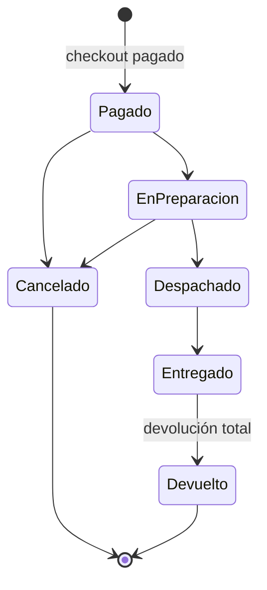

# ShopCart — Fase 1: base de datos y backend

Plataforma de ventas en línea. Esta entrega cubre la **Fase 1** del Tech Challenge 360: SQL Server (acceso exclusivo por stored procedures) y API REST en Node.js + TypeScript.

- Diagrama entidad-relación: [docs/er-diagram.md](docs/er-diagram.md)
- Referencia de la API: [docs/API.md](docs/API.md)

## Requisitos

- Node.js 22 o superior (el enunciado pide 24 LTS; el código no usa nada específico de 24 y se probó en 22.21)
- Docker (para SQL Server 2022) o una instancia propia de SQL Server 2019+

## Puesta en marcha

```bash
cp .env.example .env                    # contraseña del SA para docker compose
cp backend/.env.example backend/.env    # configuración del backend (ajusta DB_PASSWORD para que coincida)
docker compose up -d                    # SQL Server en localhost:1433
cd backend
npm install
npm run db:migrate                      # crea la base ShopCart, objetos y datos semilla
npm run dev                             # API en http://localhost:3000
```

> En `.env` los valores con `#` deben ir entre comillas (`DB_PASSWORD="Clave#123"`), de lo contrario `dotenv` los trunca.
> En Apple Silicon la imagen de SQL Server corre con emulación `linux/amd64`; el primer arranque tarda un poco.

Comandos útiles (desde `backend/`):

| Comando | Qué hace |
|---|---|
| `npm run db:migrate` | Aplica los scripts de `database/scripts` que falten (idempotente, registra en `SchemaMigracion`) |
| `npm run db:reset` | Elimina y recrea la base desde cero (deshabilitado con `NODE_ENV=production`) |
| `npm run typecheck` / `npm run build` | Verificación estricta de tipos / compilación |
| `npm run smoke` | Prueba end-to-end de los criterios de aceptación contra la API en ejecución. **Modifica datos**: correrlo sobre una base recién creada (`db:reset`) |

## Credenciales de prueba

| Rol | Correo | Contraseña |
|---|---|---|
| Administrador | `admin@shopcart.test` | `Admin#2026` |
| Operador | `operador@shopcart.test` | `Operador#2026` |
| Cliente (con dirección) | `cliente@shopcart.test` (también `cliente2@…` y `cliente3@…`) | `Cliente#2026` |

Cupones de prueba: `BIENVENIDA10` (10 %, mín. Q100), `Q50FIJO` (Q50, mín. Q300), `ROPA20` (20 % solo categoría Ropa), `UNSOLOUSO` (1 uso total), `VENCIDO`. La variante `SKU-ULTIMA-UNIDAD` tiene una sola unidad para probar la compra concurrente. Hay 250 pedidos históricos para que los reportes tengan datos.

## Estructura

```
database/scripts/   Scripts SQL numerados (001 base → 006 vistas/funciones → 010-018 SPs → 090+ semillas)
backend/src/
  config/           Variables de entorno validadas con zod
  database/         Pool, ejecutor de SPs con parámetros tipados, runner de migraciones
  shared/           Errores, middleware (auth, roles, errores), paginación, esquemas comunes
  modules/<modulo>/ routes (HTTP + validación) → service (orquestación) → repository (llama SPs)
```

Estándar de nombres de la base: `SP_Modulo_Proceso`, `VW_Modulo_Proceso`, `FU_Modulo_Proceso`, llaves `IDProducto`, `IDPedido`… Todo creado con scripts SQL propios, sin ORM.

## Cómo se aplican los principios de diseño

- **Responsabilidad única / capas**: las rutas solo validan entrada (zod) y responden; los repositorios solo invocan SPs; los servicios existen donde hay orquestación real (sesiones, hashing, tokens, fusión de carrito). No se crean servicios que solo reenvían una llamada.
- **Una sola fuente de verdad para las reglas críticas**: existencia, cupones, transiciones de estado y devoluciones se resuelven *dentro* de la base, en transacciones, y además están protegidas con `CHECK`, índices únicos y triggers. El backend no repite esas reglas, así que no pueden divergir.
- **Abierto/cerrado**: el ciclo de vida del pedido es *datos* (`EstadoPedido`, `TransicionPedido`); cambiarlo no requiere tocar código. Los reportes parten de vistas (`VW_Pedidos_Completados`) y un único cálculo de descuento (`FU_Cupones_CalculoDescuento`) que sirven al carrito, al checkout y a la validación.
- **Inversión de dependencias y KISS**: un solo punto de acceso a SQL (`database/procedures.ts`) con tipos de parámetro explícitos; sin frameworks de DI ni abstracciones especulativas. Hash de contraseñas con `scrypt` de `node:crypto` (sin dependencias nativas).
- **Seguridad**: contraseñas con scrypt + sal; JWT de 15 min y refresh token opaco con rotación (se guarda solo su SHA-256; reutilizar uno rotado revoca toda la familia); roles validados en el backend; `helmet`, CORS por lista blanca, límite de intentos en `/auth`; sin concatenación de SQL en ningún SP ni en el backend; sin credenciales en el repositorio.

## Decisiones de diseño y supuestos (decisiones abiertas del enunciado)

**Ciclo de vida del pedido**



- Se puede cancelar mientras no esté despachado (el cliente sus propios pedidos; operador/administrador cualquiera). Cancelar reintegra la existencia con una entrada de kardex, marca el pago como reembolsado y libera el uso del cupón.
- Las devoluciones (solo sobre pedidos *Entregados*) las registra un operador o administrador, por línea y con cantidad parcial. La mercancía vuelve al inventario como `Devolucion`. Cuando todas las líneas quedan devueltas el pedido pasa a *Devuelto*. El monto devuelto por línea se calcula acumulado (no unidad por unidad) para que la suma de devoluciones nunca se desvíe del total por redondeo.
- La transición se valida en el SP **y** en un trigger de `Pedido` contra la tabla `TransicionPedido`.

**Reportes**: "pedido completado" = *Entregado*. Los montos se netean con las devoluciones; los cancelados y los totalmente devueltos no cuentan. Los días/semanas (lunes a domingo)/meses se agrupan en **UTC**. El ticket promedio usa el mismo conjunto de pedidos.

**Pagos**: no hay pasarela real. El cobro se registra dentro de la misma transacción que crea el pedido (`Pago`, estado `Aprobado`), de modo que un reintento nunca cobra dos veces. En una integración real, la llamada a la pasarela usaría la misma clave de idempotencia.

**Idempotencia y concurrencia (RF-06)**

- `POST /checkout/:id/pay` exige `Idempotency-Key`. El SP toma un bloqueo de actualización sobre la fila del checkout; si ya existe un pedido para ese checkout devuelve el mismo (`200`). Índices únicos `(IDCheckout)` y `(IDUsuario, ClaveIdempotencia)` son la última defensa. Probado con 5 pagos simultáneos.
- La reserva se hace al iniciar el pago: bloquea las variantes del carrito (`UPDLOCK`), valida y recién entonces incrementa `ExistenciaReservada`. `CHECK (Reservada <= Fisica)` impide la sobreventa aunque falle el código. Si dos clientes piden la última unidad, uno recibe `409` con el SKU afectado.
- Las reservas vencen a los 15 min (`RESERVATION_MINUTES`). Se liberan de forma perezosa (al iniciar un checkout o intentar pagar) y por un barrido cada 60 s (`SP_Reservas_LiberarVencidas`).
- Cupones: el uso se consume al **pagar**, no al aplicarlo, con `UPDATE … WHERE UsosActuales < LimiteUsosTotal`; esa fila bloquea a los demás compradores del mismo cupón, por lo que el límite por cliente también se evalúa en serie. Los deadlocks se reintentan hasta 3 veces.

**Precios y descuentos**: el checkout congela precio unitario y descuento por línea (`ReservaExistencia`) y el pedido copia SKU, nombre y montos (`PedidoDetalle`). Cambiar un precio después no altera pedidos hechos. El descuento del cupón se prorratea entre las líneas elegibles (el resto del redondeo va a la línea mayor) y nunca supera la base elegible, así que el total no baja de cero. El monto mínimo del cupón se compara contra el subtotal de **todo** el carrito. Los precios ya incluyen IVA del 12 %; no se desglosa en esta fase.

**Catálogo**: un producto con historial (ventas, kardex o reservas) **se desactiva**; solo se elimina físicamente si no tiene ninguno. Es más estricto que el enunciado a propósito, para no perder el kardex. Los atributos de variante se guardan como JSON validado con `ISJSON`. Los productos sin variantes activas no aparecen en la tienda. El filtro por rango de precio considera el rango de precios de las variantes del producto.

**Carritos**: un invitado se identifica por `X-Cart-Token`; al iniciar sesión con ese encabezado su carrito se fusiona (cantidades limitadas a la existencia). Un carrito está abandonado cuando tiene productos y no se toca en `CART_ABANDON_MINUTES` (24 h por defecto). Las rutas del carrito nunca reciben el id del carrito: se deduce del token, por lo que no se puede apuntar al de otro cliente.

**Autorización**: el cliente que pide un recurso ajeno recibe `403` (existe pero no es suyo) y `404` si no existe. Un usuario desactivado no puede iniciar sesión ni renovar tokens; su access token sigue siendo válido hasta 15 min.

**Bitácora**: la escriben los SPs de productos, variantes (precios), existencias, cupones y pedidos. Un trigger `INSTEAD OF` rechaza `UPDATE` y `DELETE`.

## Limitaciones conocidas (honestas)

- `SP_*_Listar` devuelve el total con `COUNT(*) OVER()`, por lo que si se pide una página fuera de rango el total aparece como `0`.
- `TRUNCATE TABLE Bitacora` no lo detiene un trigger; en producción se resolvería con permisos (`DENY`) del usuario de aplicación.
- La cuenta usada en desarrollo es `sa`; en producción debe usarse un usuario con permiso solo de `EXECUTE` sobre los SPs.
- El `smoke` no usa un framework de pruebas ni corre en CI; es una verificación end-to-end ejecutable a mano.
- El frontend (React) corresponde a la Fase 2.
